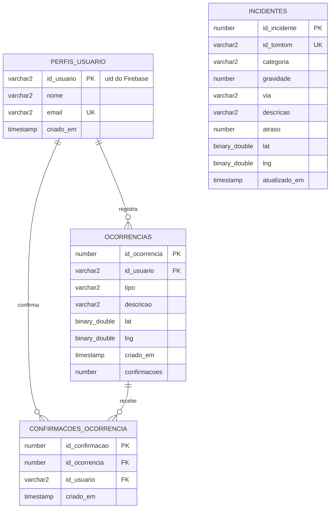
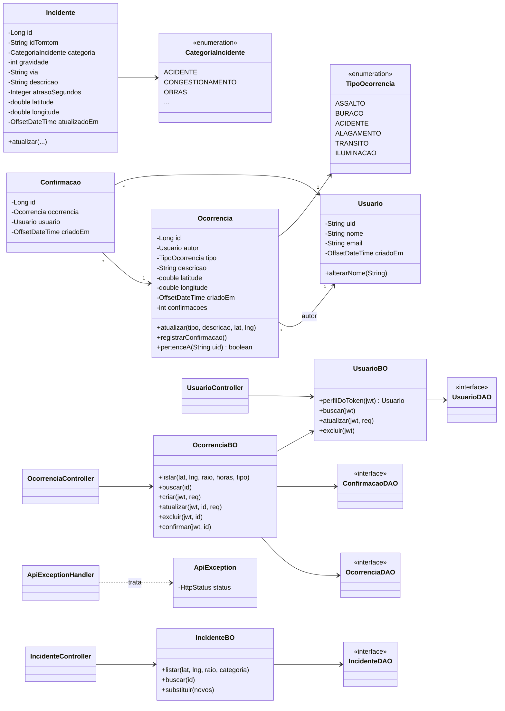

# SafeMove: API Java (Domain Driven Design)

Base para o PDF da entrega. Preencha o que está entre `<...>`.

- **Integrantes (ordem alfabética):**
  - Alexandre Martins Lucas · RM 561732
  - Gabriel Barbosa da Silva · RM 570133
  - Pedro Rodrigues Almeida · RM 564711
  - Vitor Carvalho Alexandre · RM 562298
- **GitHub:** https://github.com/PedroAlmeida232/SafeMove
- **Deploy (Render):** `<https://safemove-api.onrender.com>` (a raiz abre o Swagger)

## 1. Estrutura em camadas

Spring Boot 4.1 · Java 21 · Spring Data JPA · Oracle (FIAP) · Spring Security (token do Firebase) · springdoc (Swagger).

| Pacote (`backend/src/main/java/com/safemove/`) | Camada | Conteúdo |
|---|---|---|
| `model` | Modelo | Entidades JPA mapeadas para as tabelas Oracle: `Usuario`, `Ocorrencia`, `Confirmacao`, `Incidente` e os enums `TipoOcorrencia`, `CategoriaIncidente` |
| `dao` | DAO | Acesso ao banco com Spring Data JPA: `UsuarioDAO`, `OcorrenciaDAO`, `ConfirmacaoDAO`, `IncidenteDAO` |
| `bo` | BO | Regras de negócio e transações: `AuthBO`, `UsuarioBO`, `OcorrenciaBO`, `IncidenteBO` |
| `controller` | Controller | Endpoints REST (GET, POST, PUT, DELETE): `AuthController`, `UsuarioController`, `OcorrenciaController`, `IncidenteController` |
| `dto` | DTO | Corpos de requisição (com Bean Validation) e de resposta |
| `exception` | Exceções | `ApiException` + `ApiExceptionHandler` (`@RestControllerAdvice`) e `JsonErrorHandlers` (erros de segurança). Todo erro sai como `{ status, detail, campos? }` |
| `integracao` | Integrações | `FirebaseAuthClient` (login) e `TomTomClient` (trânsito) |
| `agendamento` | Job | `IncidenteSincronizador`: atualiza os incidentes da TomTom a cada 2 min |
| `config`, `geo` | Apoio | Segurança, Swagger, fuso horário, cálculo de distância |

Fluxo de uma requisição: **Controller → BO → DAO → Oracle**. Os erros lançados em qualquer camada viram a resposta JSON no `ApiExceptionHandler`.

### Regras de negócio (BO)

- Ocorrência só pode ser registrada dentro da Grande São Paulo (422).
- Só o autor altera (PUT) ou exclui (DELETE) uma ocorrência (403).
- "Eu também vi": cada usuário confirma uma ocorrência uma única vez (409) e não pode confirmar a própria (422).
- Buscas por raio: até 50 km; ocorrências nas últimas 1 a 720 horas (400 fora disso).
- Excluir a conta apaga perfil, ocorrências e confirmações, e o usuário no Firebase, numa única transação.

## 2. Endpoints

🔒 = exige `Authorization: Bearer <token>` (o `token` devolvido por `/auth/login`).

| Método | Rota | Descrição | Sucesso | Erros |
|---|---|---|---|---|
| POST | `/auth/register` | Cria conta (`nome`, `email`, `senha`) | 201 | 400, 409 |
| POST | `/auth/login` | Entra (`email`, `senha`) e devolve `token`, `refreshToken`, `usuario` | 200 | 400, 401 |
| POST | `/auth/refresh` | Renova o token (`refreshToken`) | 200 | 401 |
| POST | `/auth/recuperar-senha` | Envia e-mail de redefinição (`email`) | 204 | 400 |
| GET 🔒 | `/usuarios/me` | Perfil de quem está logado | 200 | 401 |
| PUT 🔒 | `/usuarios/me` | Altera o nome (`nome`) | 200 | 400, 401 |
| DELETE 🔒 | `/usuarios/me` | Exclui a conta | 204 | 401 |
| GET | `/ocorrencias?lat&lng[&raio][&horas][&tipo]` | Ocorrências próximas (padrão 2 km, 24 h) | 200 | 400 |
| GET | `/ocorrencias/{id}` | Uma ocorrência | 200 | 404 |
| POST 🔒 | `/ocorrencias` | Registra (`tipo`, `descricao?`, `latitude`, `longitude`) | 201 | 400, 401, 422 |
| PUT 🔒 | `/ocorrencias/{id}` | Altera (mesmo corpo do POST; só o autor) | 200 | 400, 401, 403, 404, 422 |
| DELETE 🔒 | `/ocorrencias/{id}` | Exclui (só o autor) | 204 | 401, 403, 404 |
| POST 🔒 | `/ocorrencias/{id}/confirmar` | "Eu também vi" | 200 | 401, 404, 409, 422 |
| GET | `/incidentes[?lat&lng&raio][&categoria]` | Incidentes de trânsito (TomTom) | 200 | 400 |
| GET | `/incidentes/{id}` | Um incidente | 200 | 404 |

Exemplo de corpo de `POST /ocorrencias`:

```json
{ "tipo": "BURACO", "descricao": "Buraco grande na faixa da direita", "latitude": -23.5613, "longitude": -46.6565 }
```

Exemplo de erro:

```json
{ "status": 400, "detail": "Escolha o tipo da ocorrência.", "campos": { "tipo": "Escolha o tipo da ocorrência." } }
```

## 3. DER

Script completo em [`safemove-oracle.sql`](safemove-oracle.sql).



`INCIDENTES` não tem relacionamento: é uma cópia dos dados da TomTom, trocada a cada sincronização.

## 4. Diagrama de classes



Os diagramas em Mermaid podem ser exportados como imagem em <https://mermaid.live> para colar no PDF.

## 5. Como executar

### Ferramentas e versões

| Ferramenta | Versão |
|---|---|
| Java (JDK) | 21 |
| Maven | wrapper incluso (`./mvnw`), não precisa instalar |
| Spring Boot | 4.1.2 |
| Banco | Oracle da FIAP (`oracle.fiap.com.br:1521:ORCL`); H2 em memória no perfil `dev` |
| IDE | IntelliJ IDEA (ou qualquer IDE Java) |
| Docker | opcional, só para testar a imagem do deploy |

### Passo a passo (local)

1. Clone o repositório e entre em `backend/`.
2. Copie `.env.example` para `.env` e preencha `ORACLE_USER`, `ORACLE_PASSWORD` (seu RM e senha do Oracle FIAP), `FIREBASE_PROJECT_ID`, `FIREBASE_API_KEY` e `TOMTOM_API_KEY`.
3. Rode com Oracle:

   ```bash
   ./mvnw spring-boot:run
   ```

   ou sem Oracle (H2 em memória):

   ```bash
   ./mvnw spring-boot:run -Dspring-boot.run.profiles=dev
   ```

4. Abra <http://localhost:8080> (redireciona para o Swagger). Para as rotas 🔒: faça `POST /auth/login`, copie o `token` e clique em **Authorize**.
5. Testes: `./mvnw test`.

As tabelas são criadas automaticamente na primeira execução (`ddl-auto=update`).

### Deploy no Render

1. No Render: **New › Blueprint** e selecione o repositório no GitHub. O arquivo `render.yaml` da raiz cria o serviço `safemove-api` (Docker, plano free) a partir de `backend/Dockerfile`.
2. Preencha as variáveis pedidas: `ORACLE_USER`, `ORACLE_PASSWORD`, `FIREBASE_PROJECT_ID`, `FIREBASE_API_KEY`, `TOMTOM_API_KEY`.
3. Aguarde o build. A URL pública (`https://<nome>.onrender.com`) abre o Swagger.

No plano free o serviço "dorme" após 15 min sem uso; a primeira requisição depois disso demora ~1 min.
